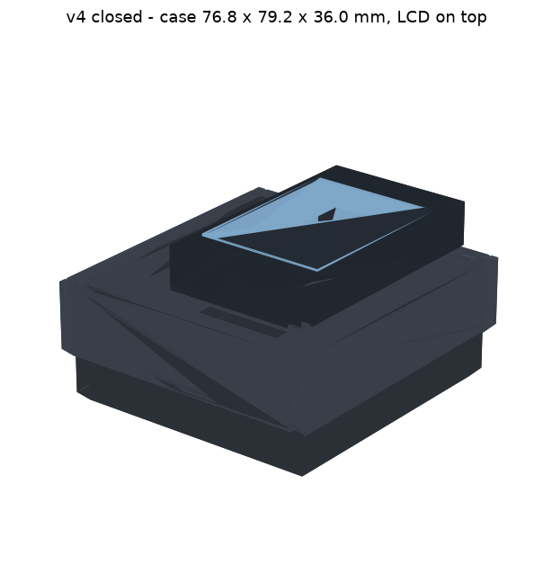
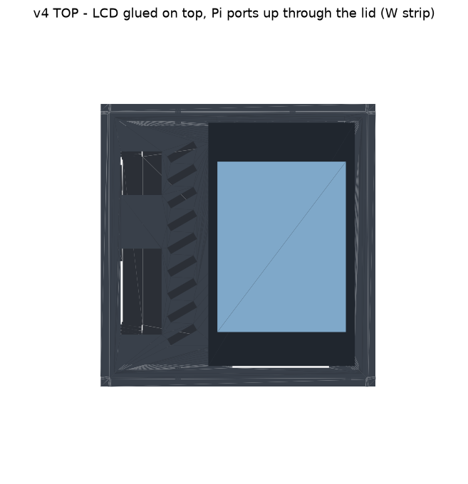

# Pi Zero Console Case for the GMT024-08 2.4" SPI LCD (ST7789V)

**A tiny console for a tiny computer.**

A two-part 3D-printable enclosure that turns a Raspberry Pi Zero and a
2.4" GMT024-08 SPI display into a tidy little desktop console — no
breadboard, no spaghetti of jumper wires spilling across the desk.

The Pi Zero stands on its side along one wall of the base, so its
mini-HDMI, USB and power ports all open through the top of the lid, easy
to reach. The display glues flat on top of the lid on four raised pads,
its header pins pass through a slot in the panel, and all eight jumper
wires hide in the open channel inside the case. Slide the lid over the
base skirt and it looks like it was always one gadget.

Overall size is about 77 × 79 × 36 mm — small enough to live next to a
keyboard as a status display, a mini dashboard, a clock, or the heart of
a pocket cyberdeck build.

## Board compatibility

Checked against the manufacturers' official specifications — the case is
built on the Pi Zero mechanical drawing (65 × 30 mm board, ports at
documented positions), so "same size" alone is not enough: the port
slots in the lid have to line up too.

| Board | Fits? | Why |
|---|---|---|
| Raspberry Pi Zero / Zero W / Zero WH / Zero 2 W | **Yes** | The board this case is designed around |
| Banana Pi BPI-M2 Zero | **Yes** | 65 × 30 mm; Banana Pi states its interfaces are the same as the Pi Zero W (mini-HDMI + twin micro-USB, 40-pin header) |
| Orange Pi Zero 2W | **Base yes — lid unverified** | Same 65 × 30 mm outline and, per Orange Pi, the same mounting-hole pattern as the Pi Zero — so it should sit on the case's press pins like a Pi. Its two USB ports are USB-C where the lid slots are cut for micro-USB, and its port centres aren't officially published, so whether the ports land in the lid's slots takes a physical test fit (the board's owner has one scheduled). Its stick-on Wi-Fi antenna also needs routing room the Pi doesn't. |
| Radxa Zero | No | Same 65 × 30 mm outline, but both USB ports are USB-C |
| Orange Pi Zero (original) | No | 48 × 46 mm board, 26-pin header — different shape entirely |
| Orange Pi Zero 3 | No | 50 × 55 mm board with a full-size Ethernet jack |
| Radxa Zero 2 Pro | No | 66 × 36 mm — too wide to enter the case |

The Orange Pi Zero 2W and Radxa Zero could work with a future lid
variant cut for USB-C, but their makers don't publish port-centre
dimensions, so no variant is promised from paper specs alone.

## The display matters

This case is made for the **GMT024-08-SPI8P** module: a 2.4" 240×320 TFT
on an 8-pin SPI header, driven by an **ST7789V** controller. It is *not*
an ILI9341 panel, whatever some listings imply — set your driver up for
ST7789 or you'll get a smeared picture and wrong colors.

## What you need

- A compatible board (see the table above)
- GMT024-08-SPI8P 2.4" TFT module (ST7789V, 8-pin SPI)
- 8 short female-to-female jumper wires
- A few dabs of glue (hot glue or CA) for the display pads

## Files

- `base.stl` — the case base (print floor-down)
- `lid.stl` — the lid (print flat, outer face on the plate)
- `source/build_case_v4.py` — the parametric source that generates the
  STLs (Python, needs `numpy` and `trimesh`; writes to an `out4` folder
  beside the script). Every fit-critical dimension comes from the
  official Pi Zero and GoldenMorning drawings, plus one caliper check of
  the real module.
- `software/` — how to drive the display (next section)
- `preview_3d_closed.png`, `preview_top.png` — renders of the assembled case

## Printing

Two parts, no supports. Print the base floor-down and the lid flat with
its outer face on the plate. The reference print was done on a Bambu Lab
A1 with a 0.4 mm nozzle. The case is also on MakerWorld with ready-made
print profiles for both parts:
https://makerworld.com/en/models/3673258-pi-zero-case-for-gmt024-08-2-4-spi-lcd-st7789v

## Wiring

Wire the display to the Pi before you close the case. Trust the pin
names silkscreened on the LCD — wire colors vary from set to set.

| LCD pin | Pi header | Notes |
|---|---|---|
| GND | pin 6 | Ground |
| VCC | pin 1 | **3.3V — never 5V** |
| SCL | pin 23 | GPIO 11, SPI SCLK |
| SDA | pin 19 | GPIO 10, SPI MOSI |
| RST | pin 22 | GPIO 25 |
| DC | pin 18 | GPIO 24 |
| CS | pin 26 | GPIO 7, SPI CE1 (leaves CE0 free for a second SPI board) |
| BL | pin 17 | 3.3V, backlight always on — or pin 12 / GPIO 18 if you want the Pi to switch the backlight |

## Software — two ways to use the screen

See [`software/README.md`](software/README.md) for full setup. In short:

1. **Live CLI console** — one `dtoverlay` line in the boot config turns
   the panel into the Pi's real login console (framebuffer + tty1).
   This is what the reference build runs.
2. **System stats display** — a Python script draws hostname, IPs, CPU,
   RAM, disk and uptime on the panel every 60 seconds. The script, its
   helper module, and a console-preview helper are all in `software/`.

The two modes are mutually exclusive — one panel, one owner at a time.

## Assembly

1. Connect the eight jumper wires between the LCD and the Pi header.
2. Stand the Pi in the rails in the base, ports facing up.
3. Glue the LCD onto the four pads on the lid, pins through the slot.
4. Slide the lid down over the base skirt. Done — plug in and boot.

## License

Licensed under **CC BY-NC-SA 4.0** — share and remix with credit to the
designer, non-commercial use only, derivatives under the same license.
Full text in [`LICENSE`](LICENSE).
